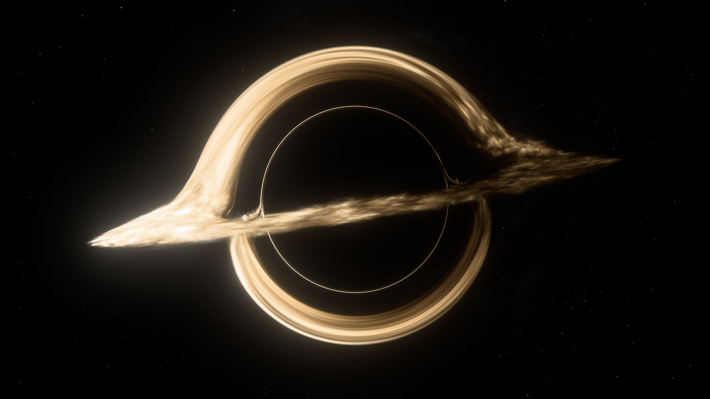
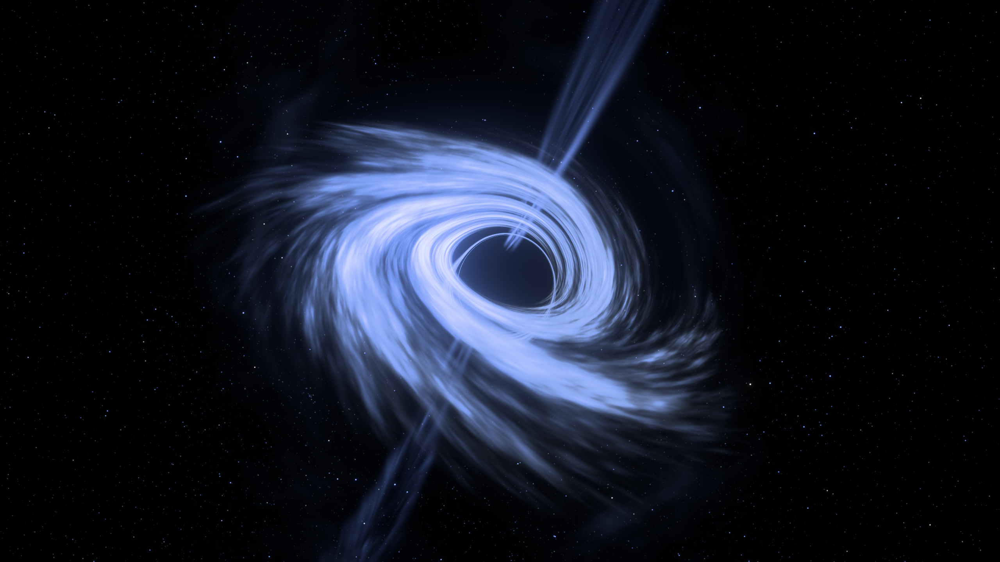

<p align="center">
  
</p>

# Nullray

**Follow light around a rotating black hole.**

A browser observatory built with TypeScript and native WebGPU. Trace light through Kerr–Newman spacetime, explore the observer's view, and make photographs of lensed accretion disks and relativistic jets.

[Get started](#get-started) · [Documentation](docs/README.md) · [Physical scope](docs/validation/coverage.md) · [MIT license](LICENSE)



_Classic disk — 2560 × 1440, 64 samples per pixel, exported directly from Nullray._

<details>
<summary>Blue accretion flow</summary>



_Blue accretion flow — 2560 × 1440, 64 samples per pixel. Both photographs use the built-in presets at a fixed epoch and SDR Display P3 output._

</details>

## What it does

- **Lensing and frequency shifts.** Light is traced backward through Kerr–Newman spacetime to a thermal disk, synchrotron jets and a catalogue sky, with Doppler and gravitational shifts applied once.
- **Physical observers.** Choose static, zero-angular-momentum, freely falling or custom-velocity observers. Moving the camera never changes the observer's velocity.
- **The extended geometry.** Place the observer between horizons, at negative radius or beside a naked singularity, and inspect where any ray ends.
- **Polarization and plasma.** View vacuum linear polarization, or a single-frequency preview of refraction in cold plasma.
- **Photographs and links.** Pause to settle the image, export a 64-sample PNG, or share the scene as a link.

Nullray is an optical prototype. Matter is prescribed, not fluid-simulated, and the spacetime does not react to it. Complete maximal-extension coverage and critical-image accuracy remain open; the [coverage ledger](docs/validation/coverage.md) lists what is implemented and what is not verified.

## Get started

You need **Node.js 26+**, **pnpm** and a recent browser with WebGPU. The renderer requires subgroups, texture formats tier 2 and WGSL read-write storage textures; see the [browser baseline](docs/engineering/development.md#native-browser-baseline).

```sh
git clone https://github.com/romeoahmed/nullray.git
cd nullray
pnpm install --frozen-lockfile
pnpm dev
```

Open the URL Vite prints, then pick a preset under **Views**.

| Input                | Action                                 |
| -------------------- | -------------------------------------- |
| Drag / arrow keys    | Orbit, or turn the camera in free mode |
| Scroll, pinch, + / − | Approach or retreat                    |
| W A S D, Q / E       | Move in free mode                      |
| Space                | Play or pause                          |
| H                    | Hide or show the controls              |
| R                    | Reset the view                         |

Playback uses native device pixels; lower scales and **Auto** are optional. Pausing settles to 16 samples per pixel, and **Photograph** always renders 64 samples at native resolution.

## Development

```sh
pnpm build       # Static checks and production bundle
pnpm test        # CPU tests and physical references
pnpm test:gpu    # GPU checks in Chromium
pnpm test:ui     # Interaction and worker lifetime
```

| Read                                             | For                                      |
| ------------------------------------------------ | ---------------------------------------- |
| [Development](docs/engineering/development.md)   | All commands, configuration, conventions |
| [Architecture](docs/engineering/architecture.md) | Code ownership and runtime contracts     |
| [Physics](docs/physics/spacetime.md)             | Conventions and equations                |
| [Validation](docs/validation/methods.md)         | How results are checked                  |

A useful bug report includes a shared view link, the browser and GPU, and the steps to reproduce.
